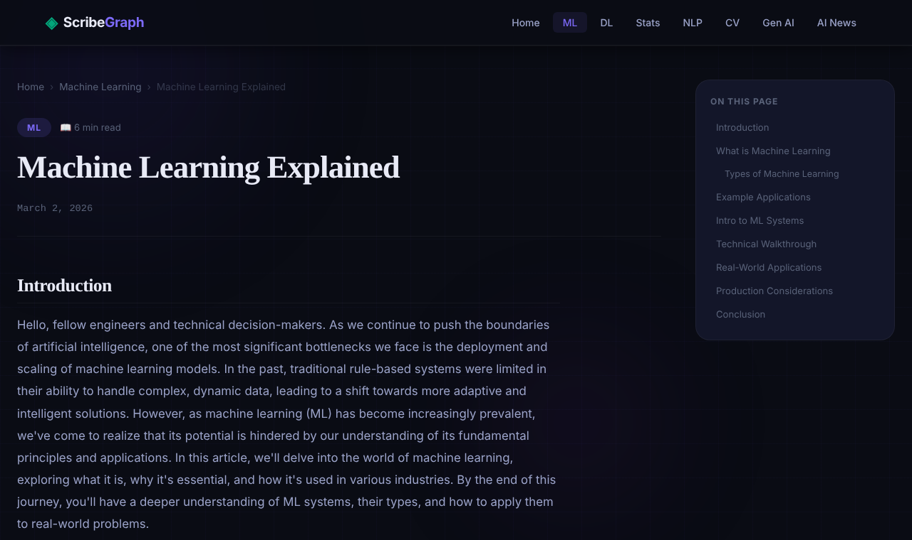
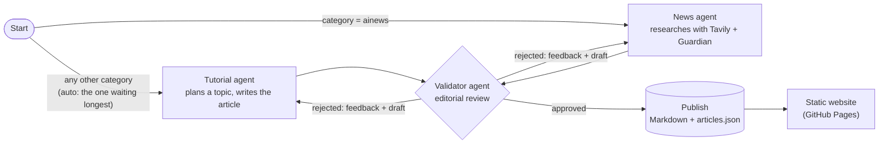

# ScribeGraph: Autonomous AI Tech Blog

[](https://github.com/HarshalPatil1026/ScribeGraph/actions/workflows/ci.yml)


[](LICENSE)

ScribeGraph is a fully automated AI blogging platform built with **LangGraph** and **Groq**.
A small team of AI agents picks a topic, writes an in-depth technical article, reviews it like
an editor, and publishes it to a modern, responsive website. GitHub Actions runs it every day,
with no human in the loop. The site renders Markdown in the browser, so there is no build step.



## Features

- **Multi-agent LangGraph workflow**: a tutorial writer, a tool-calling news researcher and an
  editor that sends drafts back with feedback until they are good enough (up to 3 rounds).
- **Autonomous editorial planning**: rotates through six categories (ML, DL, Statistics, NLP,
  CV, Generative AI), always picking the one that has waited longest, and avoids repeating
  recent topics.
- **Weekly AI news roundups** researched live with Tavily and The Guardian; the writer may only
  use facts and links from that research.
- **Fast inference on Groq** (`openai/gpt-oss-120b` by default; any Groq model works).
- **Two storage options**: commit articles to the repo and serve them free with GitHub Pages,
  or store them in a Cloudflare R2 bucket.
- **Static website with no build step**: plain HTML, CSS and JavaScript with marked,
  DOMPurify and highlight.js, a table of contents, reading progress, search and category pages.
- **Safe by default**: LLM output is sanitised before rendering, search results are treated
  as untrusted, and API keys never appear in tool errors.
- **Automated end to end**: daily generation, auto-commit and deployment with GitHub Actions.
- **Observable and tested**: optional Opik prompt library and tracing, Sentry error tracking,
  and 60 offline tests. A dry-run mode works without any API keys.

## How it works



1. **Plan.** The tutorial agent finds the category whose newest article is oldest (categories
   with no articles go first), reads the last five titles in it, and asks the LLM for a fresh
   topic as JSON.
2. **Write.** It drafts a 1,500 to 2,500 word Markdown tutorial with runnable Python where it
   helps. For AI News, a tool-calling research agent searches the past week's news first, and
   the writer may only use those notes.
3. **Review.** The validator checks depth, accuracy, completeness and structure, then returns
   JSON: either approval with a title, meta description, slug and tags, or a numbered list of
   fixes. Rejected drafts go back to the writer with the feedback and the draft itself.
4. **Publish.** The article and an updated `articles.json` index are saved. The website
   reads the index and renders the Markdown on the next page load.

## Tech stack

| Area | Tools |
|---|---|
| Agent orchestration | LangGraph 1.x (`StateGraph`, conditional edges, revision loop) |
| Tool-calling agent | LangChain `create_agent` with Tavily and Guardian search tools |
| LLM | Groq (`openai/gpt-oss-120b`) via `langchain-groq` |
| Configuration | pydantic-settings, `.env` |
| Storage | Local files (GitHub Pages) or Cloudflare R2 (S3 API via boto3) |
| Website | HTML, CSS, vanilla JavaScript, marked, DOMPurify, highlight.js |
| Automation | GitHub Actions, GitHub Pages |
| Observability | Opik (prompts and traces), Sentry |
| Tooling | uv, pytest, ruff |

## Project structure

```
ScribeGraph/
├── scribegraph/
│   ├── run.py                  # command-line entry point (`scribegraph`)
│   ├── graph/                  # LangGraph state and workflow
│   ├── agents/
│   │   ├── tutorial_agent/     # topic planning and article writing
│   │   ├── news_agent/         # web research and news roundups
│   │   ├── validator_agent/    # editorial review and publishing
│   │   └── common.py           # slugs, JSON parsing, read time, category rotation
│   ├── services/               # Groq model factory, storage backends, prompt manager
│   ├── tools/                  # Tavily and Guardian search tools
│   ├── config/                 # settings and categories
│   └── web/                    # the website (and, in local mode, the articles)
├── tests/                      # offline tests with a scripted LLM
├── .github/workflows/          # CI, daily generation, Pages deployment
├── .env.example
├── pyproject.toml
└── uv.lock
```

## Quick start

You need Python 3.12+, [uv](https://docs.astral.sh/uv/getting-started/installation/) and a
free [Groq API key](https://console.groq.com/keys).

```bash
git clone https://github.com/HarshalPatil1026/ScribeGraph.git
cd ScribeGraph
uv sync                         # creates .venv and installs the exact locked versions
cp .env.example .env            # Windows: copy .env.example .env
# open .env and set:  llm__api_key="gsk_..."

uv run scribegraph --dry-run    # offline check: no keys needed, nothing written
uv run scribegraph              # write and publish today's article
```

Then open the website:

```bash
python -m http.server 8000 --directory scribegraph/web
# visit http://localhost:8000
```

Serve the site over HTTP as shown. Opening `index.html` straight from disk blocks the
requests that load articles.

### Command-line options

| Command | What it does |
|---|---|
| `uv run scribegraph` | Picks the category that has waited longest and publishes an article |
| `uv run scribegraph --domain nlp` | Writes for a specific category (`ml`, `dl`, `statistics`, `nlp`, `cv`, `genai`, `ainews`) |
| `uv run scribegraph --domain genai --topic "LoRA fine-tuning explained"` | Writes about a topic you choose |
| `uv run scribegraph --ainews` | Weekly AI news roundup (needs a Tavily or Guardian key) |
| `uv run scribegraph --date 2026-12-01` | Sets the publication date (default: today in IST) |
| `uv run scribegraph --dry-run` | Offline preview: no API calls and nothing written |
| `uv run scribegraph -v` | Debug logging |

## Configuration

Settings come from environment variables or `.env` (see [`.env.example`](.env.example)).
Nested settings use a double underscore, and names are case-insensitive.

| Variable | Default | Purpose |
|---|---|---|
| `llm__api_key` (or `GROQ_API_KEY`) | none | Groq API key. Required, except for dry runs |
| `llm__model_name` | `openai/gpt-oss-120b` | Any Groq chat model |
| `storage__backend` | `auto` | `local`, `r2`, or `auto` (R2 when all `r2__*` values are set) |
| `r2__account_id`, `r2__access_key_id`, `r2__secret_access_key`, `r2__bucket_name` | none | Cloudflare R2 credentials |
| `content__tavily_api_key`, `content__guardian_api_key` | none | AI News research (one is enough) |
| `pipeline__max_revisions` | `3` | Rejections before the latest draft is published anyway |
| `pipeline__history_size` | `5` | Recent titles shown to the topic planner |
| `OPIK_API_KEY`, `OPIK_PROJECT_NAME` | none, `scribegraph` | Opik prompt library and tracing (`uv sync --extra opik`) |
| `SENTRY_DSN` | none | Sentry error tracking |

## Deploy and automate for free

1. **Turn on GitHub Pages:** Settings → Pages → Build and deployment → Source: **GitHub Actions**.
   Then run **Actions → Deploy site → Run workflow** once. The site will be at
   `https://harshalpatil1026.github.io/ScribeGraph/`.
2. **Add your key:** Settings → Secrets and variables → Actions → New repository secret
   → `GROQ_API_KEY`. Optional secrets: `TAVILY_API_KEY` and/or `GUARDIAN_API_KEY` (for AI News),
   `OPIK_API_KEY`, `SENTRY_DSN`.
3. **That's it.** Every day at 08:00 IST the *Generate article* workflow writes one article
   (an AI News roundup on Sundays), commits it, and *Deploy site* republishes the website.
   To publish now, open **Actions → Generate article → Run workflow**.

| Workflow | Runs on | What it does |
|---|---|---|
| CI | every push and pull request | ruff, pytest on Python 3.12 and 3.13, offline dry run |
| Generate article | daily at 02:30 UTC, or manually | runs the agents and commits the new article |
| Deploy site | website changes, after *Generate article*, or manually | publishes `scribegraph/web` to GitHub Pages |

**Using Cloudflare R2 instead:** add the secrets `R2_ACCOUNT_ID`, `R2_ACCESS_KEY_ID`,
`R2_SECRET_ACCESS_KEY` and `R2_BUCKET_NAME`, plus a repository *variable* `R2_PUBLIC_URL` (the
bucket's public URL). Articles then go to the bucket, and the deploy workflow points the website
at it. To use a different Groq model in Actions, set a repository variable `GROQ_MODEL`.

## Development

```bash
uv run pytest           # offline tests: scripted LLM, temporary storage, no API keys
uv run ruff check .     # lint
uv run ruff format .    # format
```

To try the news agent's tracing and prompt library, install the extra with
`uv sync --extra opik` and set `OPIK_API_KEY`.

## What's new compared to BlogBoard

ScribeGraph started from [BlogBoard](https://github.com/KalyanM45/BlogBoard-AI-Blog-Generator)
and was reworked and extended. Highlights:

- Fixed the AI News pipeline, which crashed on LangGraph 1.0, and the Tavily integration,
  whose API had changed.
- Moved off the retired Groq model (`llama-3.3-70b-versatile`, shut down August 2026).
- Fixed category rotation so empty categories actually get articles, and stopped new articles
  from overwriting old ones with the same slug.
- Added a local storage backend, so the whole project runs free on GitHub Pages without
  Cloudflare.
- Added sanitised rendering, a revise-with-feedback loop, tags, a real offline dry run, a test
  suite, CI, scheduled generation and automatic deployment.

See [CHANGELOG.md](CHANGELOG.md) for the full list.

## Credits

Based on [BlogBoard](https://github.com/KalyanM45/BlogBoard-AI-Blog-Generator) by
Hema Kalyan Murapaka, released under the MIT License. The original copyright notice is kept in
[LICENSE](LICENSE). Sample articles in `scribegraph/web/blogs` come from that project.

## License

[MIT](LICENSE)
